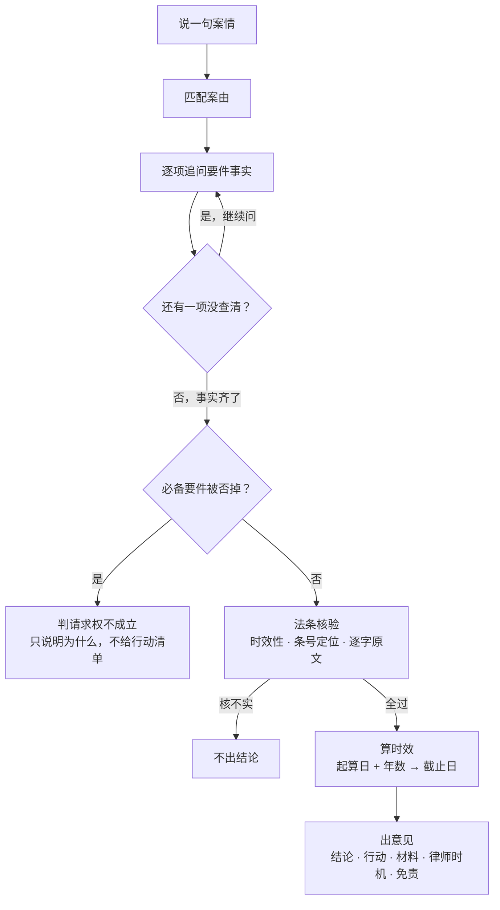

# 问律 wenlv


说出案情，它把事实问清楚，把法条核实，然后告诉你**现在该做什么、什么时候该找律师**。

不是问答机器人：**事实没问清它不答，法条核不实它不说。**

## 它长这样

```console
$ wenlv --describe "朋友借钱不还，有借条"
匹配到案由：出借人请求借款人返还借款本金（命中：借钱、借条）

[待查事实 · 1/7] 双方有没有明确说过这笔钱是"借"的、要还？
    为什么问：借款关系以借贷合意为前提。只有转账没有合意，
              可能被认定为赠与、投资款或不当得利，请求权基础完全不同。
> 不清楚
[补充追问 · 1/7] 有没有借条、欠条、还款承诺书？
> 是有借条

（中间 2/7 到 5/7 略）

[待查事实 · 6/7] 从应当还钱那天到今天，超过三年了吗？
> 否，没超三年

[时效] 三年从哪一天起算？
> 2025-12-31

进入法条核验。

  [通过] 中华人民共和国民法典第六百七十九条
          官方原文：自然人之间的借款合同，自贷款人提供借款时成立。
  [通过] 中华人民共和国民法典第一百八十八条
          官方原文：向人民法院请求保护民事权利的诉讼时效期间为三年。……

核验通过 7/7 条。

【结论】  要件事实已查明 7/7 项；法条依据 7/7 条经官方源核验通过。
          注意：依据成立不等于能赢。决定结果的是证据，不是法条。
【时效】  截止 2028-12-31，还剩 772 天，时间还算充裕。
【现在要做什么】  按本案由给的行动，加三条通用动作。
【需要准备的材料】 按要件事实逐项列，写清拿什么、为什么拿。
【什么时候请律师】 条件触发（时效告急、要件有争议）＋ 通用兜底。
【免责声明】  每次输出都带。
```

## 和别的法律 AI 不一样在哪

**它先问，不先答。** 每问一句都告诉你为什么问——这一项答不清楚，对应的法律后果完全不同。事实有一项没查清，它就不出结论，只给缺口清单。

**它不信任自己背的法条。** 每条引用都回[国家法律法规数据库](https://flk.npc.gov.cn)逐字比对。实测三种结果：

| 引用 | 结果 |
|---|---|
| 民法典第188条，原文引对 | 通过，附官方原文 |
| 同一条，编成「诉讼时效为五年」 | 判为不一致，把官方原文带出来纠正 |
| 《合同法》第206条 | 判为已废止，拒绝——那是 2021 年就失效的法，模型最爱引 |

**它算时效，不问时效。** 起算日你给，截止日和剩余天数它算。实测里有个案子，当事人自己说「没超一年」，按他给的日期一算，已经过期 172 天。

## 装

```bash
pip install git+https://github.com/mazihua-lgtm/wenlv
```

只依赖 Python 3.10+ 和 PyYAML。想改代码就 clone 下来 `pip install -e .`。

```bash
wenlv --describe "朋友借钱不还，有借条"     # 一句话匹配案由
wenlv --issue private_lending.principal   # 或者直接指定
wenlv --list                              # 列出全部案由
```

退出码：`0` 依据成立；`2` 事实不够；`3` 有引用核不实；`4` 必备要件不成立。

## 支持哪些案由

| 案由 | 请求权基础 | 要件事实 |
|---|---|---|
| `private_lending.principal` | 出借人请求借款人返还本金 | 7 项 |
| `labor.illegal_dismissal` | 劳动者请求违法解除赔偿金 | 6 项 |
| `labor.unpaid_wages` | 劳动者请求支付拖欠工资及加班费 | 6 项 |
| `sale.buyer_payment` | 出卖人请求买受人支付价款 | 6 项 |
| `lease.deposit_refund` | 承租人请求返还租赁押金 | 5 项 |
| `consumer.triple_damages` | 消费者请求退款并三倍赔偿 | 5 项 |
| `marriage.property_division` | 离婚时请求分割夫妻共同财产 | 7 项 |
| `family.child_support` | 子女请求父母支付抚养费 | 5 项 |
| `inheritance.division` | 继承人请求分割遗产 | 6 项 |
| `traffic.personal_injury` | 交通事故受害人请求人身损害赔偿 | 6 项 |

十个案由合计 **46 条法条引用**（跨案由重复的只算一次），全部能回到官方源核到原文。`python tools/check_coverage.py` 可复现。

一句话就能匹配到案由：

```
"老板拖欠工资三个月"   → labor.unpaid_wages
"房东不退押金"        → lease.deposit_refund
"网购买到假货"        → consumer.triple_damages
"离婚后前夫不给抚养费"  → family.child_support
"兄弟争遗产"          → inheritance.division
```

## 三道关

三道卡都在代码里，不在提示词里。



**事实闸。** 每个请求权基础拆成若干要件事实，状态只有「已确认 / 已否认 / 未查明」。有一项未查明就不出意见。用户答「不清楚」会触发补充追问，但绝不会被当成「否」——这个 bug 真发生过，测试里专门守着。

**时效闸。** 引用前先查这部法规在官方库里的时效性，已废止、已修改、尚未生效的一律拒绝。

**原文闸。** 不拿模型的话和模型的话比。程序拿声称的原文去官方库检索：编出来的句子在库里根本不存在，必然搜空，直接判不过；搜到了，再按条号切开、逐字比对。

还有一条：**必备要件被否掉，直接判请求权不成立**，只说明为什么，不再列"怎么起诉"。这时候还教人打官司，是往错路上推。

## 加一个案由

不用写代码，加一个 YAML 就行。自己加的放 `./issues/`（优先读），改内置的直接改 `wenlv/issues/`。

```yaml
id: labor.illegal_dismissal
claim: 劳动者请求用人单位支付违法解除劳动合同赔偿金

keywords: [辞退, 开除, 解雇, 劳动仲裁]      # 一句话匹配案由用

limitation:
  years: 1                                   # 劳动仲裁只有一年
  fact: limitation
  start_prompt: 一年从哪一天起算？
  note: 劳动仲裁时效只有一年，比普通民事的三年短得多。

actions:                                     # 现在要做什么
  - 先把能证明劳动关系的材料凑齐：劳动合同、工资流水、考勤、工牌。
  - 去劳动人事争议仲裁委员会申请仲裁——这一步不能跳过。

lawyer:                                      # 什么时候请律师
  - when: 仲裁时效可能已经过了（一年），请求会被驳回
    fact: limitation
    status: confirmed

elements:
  - key: relation
    question: 你和这家单位签过劳动合同吗？
    why: 劳动关系是赔偿请求的前提。
    essential: true                          # 否掉就判请求权不成立
    basis:
      - ref: 劳动合同法第10条
        anchor: 建立劳动关系，应当订立书面劳动合同
    probe:
      - 工资是谁发给你的，对公账户还是个人转账？
    evidence:                                # 需要准备的材料
      - 劳动合同（如有）
      - 工资流水或工资条
```

`basis` 写的是**法条指针**，不是条文正文：

- `ref` —— 法规名 + 条号，条号用阿拉伯数字，程序自己转成官方的中文写法；
- `anchor` —— 该条**首句**，必须逐字来自官方正文。官方按条号检索会漏条（命中窗口按数字切碎），按特征词检索一次就中：民法典第680条用条号查不到，加锚点后命中。
- `quote` —— 可选。留空时核验器直接填官方原文；填了就逐字比对。

锚点要取该条自己的开头句，别取条文中段的短句：第620条一开始用「买受人收到标的物时应当在约定的检验期限内检验」没通过——官方命中的片段里确实有这句话，但没切到这一条；换成完整首句后通过。短锚点会被同主题的邻条吸走。

写清单前先用 `python tools/probe.py 中华人民共和国民法典 "锚点词"` 确认条号和原文，别凭记忆写。

## 已知边界

说清楚，比藏起来有用。

- **判例不在覆盖范围内。** 裁判文书网不允许批量抓取，开源项目能合法自带的只有最高人民法院指导性案例、公报案例和各地法院典型案例，量级几千份，不是全量库。所以本项目只做法条核验，不做类案推送。这是设计取舍，不是遗漏。
- **只覆盖十个请求权基础。** 真实纠纷远不止这些，覆盖面交给人来扩展。
- **案由匹配是关键词打分，不是语义理解。** 匹配不上或最高分并列时，列出全部案由让你自己选，不瞎猜。
- **意见是模板 + 事实驱动的，不是模型写的。** 好处是稳定、可复现、不会编；代价是不会像律师那样针对个案特殊之处做临场分析。这正是它只做"流程和依据"、把"判断"留给人的原因。
- **依赖官方库在线可用。** 官方库不可用时核验返回 error 并**判为不通过**——宁可不出结论，也不出没核过的结论。

## 免责声明

本项目是技术工具，**不构成法律意见**，不能替代执业律师。输出基于当事人自述和公开法律文本，无法核实证据真伪，也不了解当地裁判口径和案件全貌。据此作出的决定，风险由使用者自行承担。

**涉及人身自由、重大财产、诉讼时效临近，或者对方已经委托律师的，请直接找执业律师。** 拖到开庭前一周再找，能做的空间会小很多。

## 开发

```bash
python -m unittest discover -s tests -t .   # 55 个测试，全部离线可跑
```

结构：

```
wenlv/
  model.py               要件事实、请求权基础、时效规则、律师触发条件
  intake/session.py      追问状态机：什么时候继续问，什么时候可以下结论
  intake/router.py       一句话匹配案由（纯关键词，不调模型）
  corpus/flk.py          国家法律法规数据库读取层（不缓存全库）
  verify/citation.py     法条核验器：时效性、条号定位、逐字比对
  report/limitation.py   时效计算
  report/opinion.py      出意见
  issues/*.yaml          案由清单（随包发布）
tools/check_coverage.py  体检：所有引用逐条核一遍，报通过率
tools/probe.py           写清单前确认条号和锚点词
```

Licensed under the [Apache License 2.0](LICENSE).
